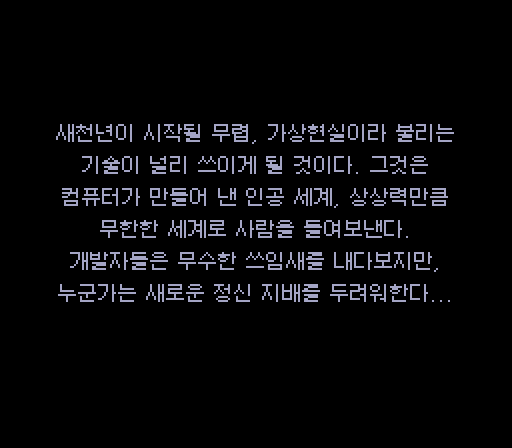
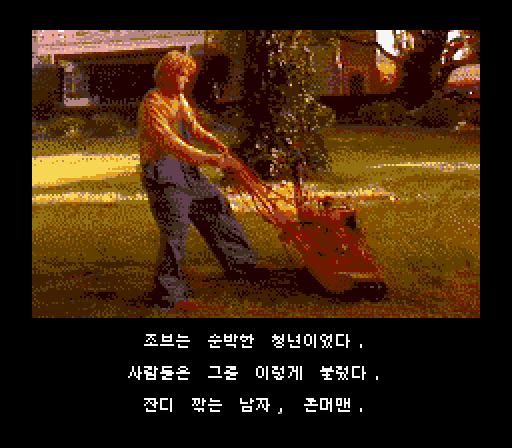
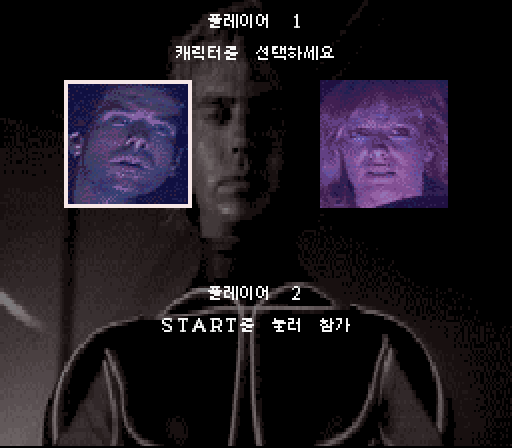
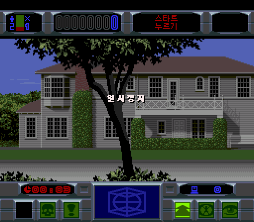

# 론머맨 — SNES 한글패치

북미판 **The Lawnmower Man**(SNES)의 비공식 한글패치 **v1.0.0 (2026-10-17)** 입니다. 외부 기계 번역 없이 직접 번역했습니다.

[정식 패치 다운로드](https://github.com/snake759494/lawnmower-man-snes-korean-patch/releases/latest) · [빌드](docs/BUILD.md) · [기술 설명](docs/TECHNICAL.md) · [검증 범위](docs/VALIDATION.md) · [권리 안내](RIGHTS.md)

## 적용 방법

1. 직접 준비한 원본 북미판 ROM(헤더 없음, 1MB)의 SHA-256이 아래 `source`와 일치하는지 확인합니다. 512바이트 헤더가 있는 `.smc`라면 헤더를 제거하세요.
2. 릴리즈에서 **Lawnmower_Man_SNES_KR.xdelta** 하나를 받습니다.
3. xdelta UI 또는 아래 명령으로 원본에 적용합니다.
4. 결과 ROM의 SHA-256을 확인한 뒤 새로 부팅합니다. 원본에서 만든 세이브 스테이트보다 콜드 부팅을 권장합니다.

```powershell
.\xdelta.exe -D -d -s 'Lawnmower Man, The (USA).sfc' 'Lawnmower_Man_SNES_KR.xdelta' 'Lawnmower Man, The (USA) (Korean).sfc'
Get-FileHash -Algorithm SHA256 'Lawnmower Man, The (USA) (Korean).sfc'
```

원본·패치·결과 해시를 한 번에 확인하려면 저장소의 `tools/apply_release.py`를 사용할 수 있습니다.

| 구분 | 바이트 | SHA-256 |
| --- | ---: | --- |
| source | 1,048,576 | `a179a1188220b59787c49a78a0dde79b89380e3a8a8a0ab558f0102c5796f873` |
| output | 2,097,152 | `636c6a4314e30b82443417688ea45c24279220ac38a1abaf98f824e2c8f7014e` |
| patch | 24,154 | `63d1d4071be31a6b5d35f5210e95c64324dea68b81ee9d7db4e3d07be6818514` |

xdelta는 **`-0 -S none -D`**로 빠르게 생성했습니다. 릴리즈 첨부는 xdelta 하나이며 ROM·폰트·외부 실행파일·저장 파일은 포함하지 않습니다.

## 한글화 내용

- 화면 문장 **69개**: 이야기 장면 7개, 엔딩 3개, 구역 진입 안내 13개, 제작진 5쪽, 라이선스, 플레이어 선택 5종 등. 플레이어 번호(1/2)가 들어가는 문장은 두 가지로 만들었습니다.
- 게임 중 아이템 메시지 **13종**(슈트 충전 완료, 유도탄 등).
- 그림 글자: 프롤로그 문단, 타이틀 로고 “론머맨”, `PAUSED`→일시정지, `DEMO MODE`→데모/플레이, HUD `PRESS START`→스타트/누르기, `ACCESS DENIED`→접근/거부, `CONTINUE`→이어하기.
- 원본 8×8 글꼴과 같은 크기의 **갈무리7**, 프롤로그는 원래 글자 높이에 맞춘 **갈무리9**를 확대·축소 없이 사용했습니다.
- 그림 교체는 원본의 영역·위치·팔레트 색 번호를 그대로 지켰습니다(로고는 흰색+회색 3단계, HUD는 원래 빨강/배경색).
- 사람 이름·회사명, THQ 로고, 원작의 THE SHOP 전용 로고 글자는 고유명사로 보존했습니다.

 
 
 

## 검증 범위

헤드리스 snes9x(libretro)로 최종 해시의 ROM을 실행해 타이틀·라이선스·프롤로그, 그림 표 46개 장면 전부(이야기·구역 진입·제작진·엔딩), 플레이어 선택, 게임 진입·일시정지·HUD, 데모 플레이, 아이템 메시지 강제 표시를 화면으로 확인했습니다. 원본 적용 및 공개 도구 재빌드의 결과 해시도 대조했습니다. 검증용 에뮬레이터는 종료했습니다.

**전편 실제 플레이, 실제 진행 중의 모든 구역 진입·엔딩 도달, 게임오버 후 CONTINUE 실제 화면, 실기 검증은 미실시입니다.** 자세한 내용은 [검증 문서](docs/VALIDATION.md)를 확인하세요.

## 공개 자료

`translation/texts.py`에 직접 번역한 한국어 문장을, `tools/`에 빌드 도구(파이썬·asar 어셈블리)를 공개합니다. 영어 원문은 포함하지 않으며 빌드 시 사용자 ROM에서 읽습니다. 재빌드에는 사용자가 준비한 원본 ROM과 해시가 맞는 공식 갈무리 글꼴·asar가 필요합니다. 이 저장소는 원작이나 글꼴의 권리를 부여하지 않습니다.

문제 제보에는 원본·결과 ROM 해시, 발생 위치, 재현 순서와 화면 캡처를 첨부해 주세요. ROM 파일과 저장 파일은 공개 이슈에 올리지 마세요.
